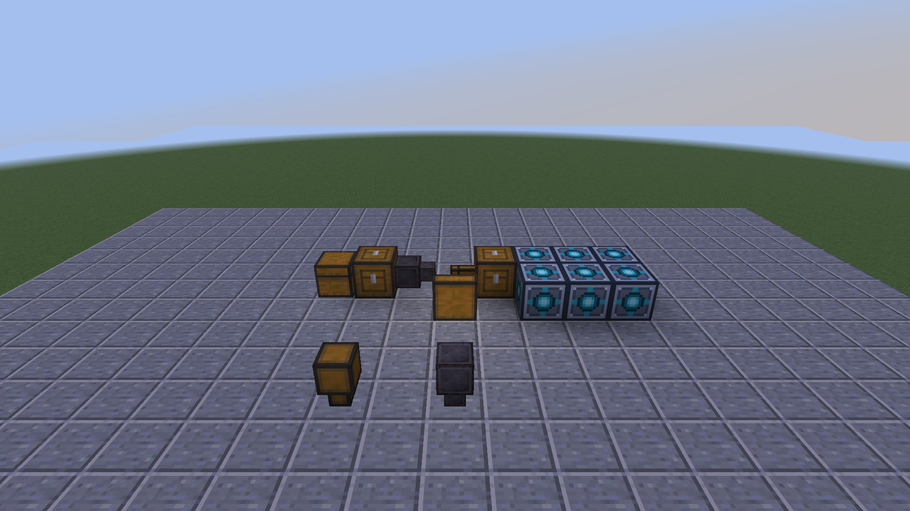

# Tom's Storage Additions

为 Tom's Simple Storage 增加**曲率存储漏斗**：传输间隔与基础存储漏斗相同，每次最多传输一格物品。

适用于 **Minecraft 26.3 / Fabric**。只需 Tom's Storage 本体，也可以搭配 [TVSN](https://github.com/YMXKNebula/toms-virtual-storage-network) 使用。

[下载 1.0.0](https://github.com/YMXKNebula/toms-storage-additions/releases/tag/v1.0.0) · [反馈问题](https://github.com/YMXKNebula/toms-storage-additions/issues)



前排左为基础存储漏斗，右为曲率存储漏斗；后方展示可选的 TVSN 仓库接法。截图摄于独立测试世界，TVSN 不是本模组的安装依赖。

## 曲率存储漏斗

曲率漏斗沿用基础存储漏斗的形状、六向摆放和操作方式，外观使用带有四周边线的下界合金块纹理。

在锻造台放入以下材料，产出一个曲率存储漏斗：

| 模板栏 | 装备栏 | 材料栏 |
| --- | --- | --- |
| 下界合金升级模板 ×1 | Tom's 基础存储漏斗 ×1 | 下界合金锭 ×1 |

每次成功传输的间隔沿用原模组的 `basicHopperCooldown` 设置。基础漏斗每次传一件；曲率漏斗每次最多传一格，因此满格时的吞吐量更高。

- 堆叠上限由游戏决定。例如上限为 64 的方块、16 的末影珍珠、1 的钻石镐，单次分别最多传 64、16、1 件。修改物品堆叠上限后，传输量随之改变。
- 普通容器输入时只处理一个源格，不会继续拿下一格来凑满。
- 源格不足或目标空间不足时，传输实际能容纳的数量，不等待凑满一组。
- 网络导出时单次最多取一组，不会一次取走整个网络的库存。
- 保留原有过滤、方向、红石禁用和物品数据。基础漏斗的行为保持不变。

右键物品设置过滤，潜行空手右键清除过滤。创造模式可在“功能方块”分类找到它。

## 接法

至少一侧需要基础存储漏斗能够识别的 Tom's Storage 网络。它不用于两个普通箱子之间的独立转运。

搭配 TVSN 导入仓库时，可以这样连接：

```text
普通箱子 → 源存储连接器 → 曲率漏斗 → 存储线缆 → 目标存储连接器 → 虚拟木桶
```

也可以将普通箱子直接接在漏斗输入侧。不要再用其他线路把输入与输出两侧接回同一网络，避免物品回流。虚拟木桶必须经连接器存取，不能直接接曲率漏斗。

普通输入箱、漏斗及两侧必要连接器需要处于已加载区块。卸载时暂停，访问条件恢复后继续；本模组不会强制加载区块。

## 安装

| 依赖 | 版本 |
| --- | --- |
| Minecraft | 26.3 |
| Java | 25 或以上 |
| Fabric Loader | 0.19.5 或以上 |
| Fabric API | 适用于 26.3，0.165.0+26.3 或以上 |
| Tom's Simple Storage | **2.12.2** |
| TVSN | 可选，支持 1.0.0 和旧版 0.2.2-dev |

下载 `toms-storage-additions-26.3-1.0.0.jar`，放入客户端和服务端的 `mods` 文件夹。单人游戏只需安装到客户端。更新时替换旧补充包，不要并装多个版本；源码 JAR 不放入 `mods`。

安装前正常停服并备份完整世界。本模组不改 TVSN 的木桶 ID、容量或账本格式，已有虚拟仓库无需迁移。仍有曲率漏斗的世界，不宜直接移除本模组后继续保存。

TVSN 1.0.0 已包含连接器重载恢复修复。本补充包还为旧 TVSN 0.2.2-dev 保留同一问题的兼容补丁；其他版本不会套用这个内部兼容补丁。未安装 TVSN 时也能正常使用曲率漏斗。

## 开发与许可

[构建与测试](docs/development.md) · [验证记录](docs/testing.md)

代码采用 MIT 许可。模型基于 Tom's Storage 基础漏斗，方块纹理引用 Minecraft 原有下界合金块；详见[第三方资源说明](THIRD_PARTY_NOTICES.md)。
