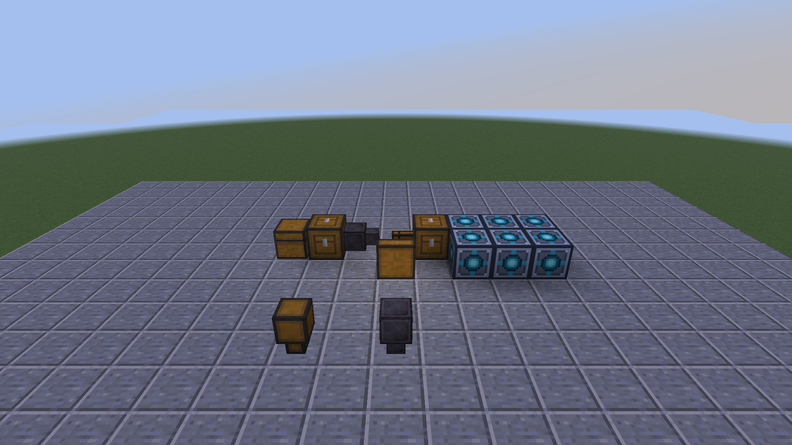

适用于 **Minecraft 26.3 / Fabric / Tom's Simple Storage 2.12.2**。

## 曲率存储漏斗

传输间隔与基础存储漏斗相同，单次最多传输一格。源格不足或目标空间不足时传输实际可容纳的数量；物品堆叠上限随游戏设置变化，不等待凑满一组。

锻造配方：**下界合金升级模板 ×1 + Tom's 基础存储漏斗 ×1 + 下界合金锭 ×1**。

保留基础漏斗的方向、过滤和红石操作，使用带四周边线的下界合金块外观。基础漏斗仍然每次传一件。

只需要 Tom's Storage 本体，不强制依赖 TVSN。搭配 TVSN 时，虚拟木桶仍通过连接器存取。截图前排展示基础漏斗与曲率漏斗，后方是可选的 TVSN 仓库接法。

## 安装与更新

客户端和服务端都安装 `toms-storage-additions-26.3-1.0.0.jar`。

需要 Java 25 或以上、Fabric Loader 0.19.5 或以上、适用于 26.3 的 Fabric API 0.165.0+26.3 或以上，以及 Tom's Storage **2.12.2**。

正常停服并备份完整世界后替换旧补充包，不要同时安装多个版本。搭配 TVSN 1.0.0 可直接使用；对旧 TVSN 0.2.2-dev 保留连接器重载兼容补丁。本补充包不改虚拟木桶账本格式。

`-sources.jar` 用于开发，不放进 `mods`。`SHA256SUMS.txt` 用于核对下载文件。完整源码和接线说明见[项目主页](https://github.com/YMXKNebula/toms-storage-additions/tree/v1.0.0)。

这是首次公开版本。四组各 18 项服务器测试全部通过，包含两组堆叠设置、持续少量补货与实际区块重载。具体范围见[验证记录](https://github.com/YMXKNebula/toms-storage-additions/blob/v1.0.0/docs/testing.md)。
